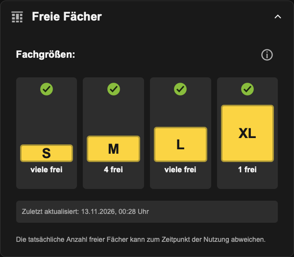
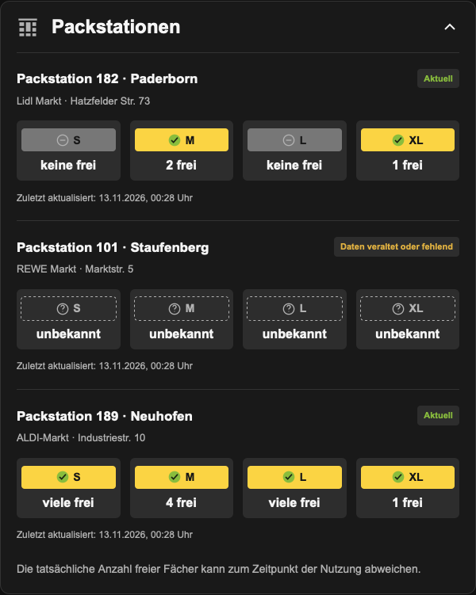

# DHL Packstation

Home Assistant integration for the free S, M, L, and XL compartments of German DHL Packstations. Set up each station from the Home Assistant interface using its postal code and Packstation number. No DHL account or developer key is required.

**Status: public beta, 0.2.0b2.** Available as a custom repository; not yet included in the default Marketplace catalog. This is an independent community project, not an official DHL product. Field testing is still in progress.

[Deutsche Installationsanleitung](docs/INSTALLATION_DE.md)

## What it provides

Each station becomes one device with six entities:

| Entity | Purpose |
| --- | --- |
| Free S / M / L / XL compartments | The exact nonnegative count returned by DHL, including zero |
| DHL data timestamp | The time of DHL's observation, converted to an aware timestamp |
| DHL data stale or missing | A diagnostic problem indicator for missing, old, or implausibly future-dated timestamps |

One shared request per station runs every 15 minutes. Counts expire after 60 minutes by default, without waiting for the next HTTP request. Change the accepted age (30–1440 minutes) in the integration's options. This is a local freshness policy, not a DHL guarantee.

Missing or invalid counts become unavailable individually. Missing, invalid, or old timestamps make all four counts unavailable. A network error makes every entity unavailable until a successful update. The timestamp remains visible when a successful response contains old data. Up to five minutes of forward clock skew is tolerated. On HTTP 429 the integration waits at least 15 minutes and honors a longer `Retry-After`, in either seconds or HTTP-date form.

## Requirements

- Home Assistant **2026.10.4 or newer** (Python 3.14.2 or newer when running Core yourself).
- Internet access from Home Assistant to `www.dhl.de` over HTTPS.
- A Packstation whose availability DHL exposes. A valid station can still have no live data.

## Installation

### Marketplace / HACS

Add **`https://github.com/TimMixedIt/dhl-packstation`** as a **custom repository**, category **Integration**, then download it. Restart Home Assistant and add **DHL Packstation** under Devices & services. With only beta releases available, the default `main` branch can be installed; enable pre-release versions if you want to select the tagged beta explicitly.

### Manual ZIP installation

1. Extract the installation ZIP. Copy its `custom_components/dhl_packstation` folder to `<HA config>/custom_components/dhl_packstation`. The final path must contain `manifest.json` directly inside `dhl_packstation`.
2. Restart Home Assistant after this manual installation.
3. Go to **Settings → Devices & services → Add integration → DHL Packstation**.
4. Enter the postal code **of the station**, and its Packstation number. Repeat for additional stations.
5. Open the device to see its entities. Diagnostics may appear in a separate section.

No YAML configuration is used. If you tried the earlier REST example, remove that example yourself after verifying the new integration; its entities are separate and are not migrated or deleted automatically.

For Home Assistant 2026.11 and newer, the Marketplace is under Settings. For older supported versions, use HACS.

## Dashboard cards

**Both cards are included and loaded automatically by the integration.** No second repository, card dependency, or manual resource entry is required. Reload your browser once after adding the integration so the new cards load. The integration never changes your dashboard automatically.

Edit a dashboard → Add card, then choose:

- **DHL Packstation · Freie Fächer**: the single-station card, with four yellow compartment shapes, availability icons, timestamp, help dialog and collapsible header.
- **DHL Packstation · Mehrere Stationen**: compact rows for comparing several stations, with S/M/L/XL, address, timestamp and separate freshness status per station.

Use the visual card editor to select a station or restrict the overview to selected stations. Without a selection, the overview shows all configured stations. Above five compartments, the default is “many free”, as on DHL's page. Turn on exact counts in the editor if preferred. Renaming an entity or changing the system language does not break the station-to-sensor mapping. Clicking a compartment opens the corresponding HA more-info dialog.

The cards use HA theme colors in light and dark mode. Unknown/stale/unreachable values have distinct neutral states and never appear as zero. Yellow shape heights illustrate compartment **size**, not occupancy.

The following previews use test fixture data, not live availability:

| Single station | Several stations |
| --- | --- |
|  |  |

Optional YAML examples (the visual editor is sufficient):

```yaml
type: custom:dhl-packstation-card
station: "1-67141189"
show_exact: false
```

```yaml
type: custom:dhl-packstation-overview-card
# Omit stations to show every configured station.
stations:
  - "1-67141189"
  - "1-33104182"
```

Station identifiers can be read from the entities' `dhl_packstation_id` attribute; they are also selected directly by name in the editor.

## Remove or update

Remove a station from Devices & services. Its HTTP polling and expiry callback stop when it unloads. Other configured stations continue working.

For a manual update, back up the current component folder, replace it with the new folder, and restart Home Assistant. Stable station identifiers keep entity identities across reloads. Remove the folder only after removing all its entries, then restart. Restore the previous folder and restart to roll back an unsuccessful beta update.

## Limits and troubleshooting

- This uses the **DHL website's interface**, not a contracted third-party availability API. URLs, fields, and access restrictions can change.
- Compartment numbers are an observation, not a reservation or promise of availability when you arrive. They do not identify a particular parcel or open a locker.
- DHL's page displays “many free” above five compartments; the underlying response may contain the exact number.
- “Unavailable” is not the same as zero free compartments. Check the timestamp, freshness diagnostic, and Home Assistant logs.
- A station-not-found error means the exact postal code, number, and location type could not be verified. A nearby station is never accepted automatically.
- A blocked or unavailable DHL service is not bypassed. Wait before trying setup again if requests are limited.
- The integration does not calculate occupancy percentages: no verified per-size total capacity is available.

Home Assistant generates entity IDs from names and language. Use the actual entity IDs shown by your installation in automations, and check availability before numeric comparisons. There are no custom actions, triggers, webhooks, or reservations.

## Privacy

During setup, the station's postal code and number are sent to DHL to find its public location identifier. Subsequent requests send that identifier. DHL also sees the requesting IP address. Identifiers are saved in Home Assistant's config entry. No DHL credentials, parcel numbers, personal Postnummer, analytics, or external proxy service are used.

## Development and verification

Current test environment:

```sh
uv venv --python 3.14
uv pip install --python .venv/bin/python --group dev
.venv/bin/ruff check .
.venv/bin/ruff format --check .
.venv/bin/python -c 'import homeassistant; import pytest; raise SystemExit(pytest.main(["-q", "--cov"]))'
```

The Home Assistant import before pytest initializes its HTTP library aliases before unrelated pytest plugins load. For the 2026.10.4 compatibility run, use a separate environment with `pytest-homeassistant-custom-component==0.13.375` and `ruff==0.14.5` instead of the current development group. Tests use the matching helper package in each environment. No Home Assistant dependency is overridden to force an incompatible test harness.

Run the dependency-free JavaScript checks with Node.js 22 or newer:

```sh
node --test tests/frontend/*.test.mjs
```

The browser CI jobs run the real bundled elements in Chromium and WebKit with Home Assistant state fixtures. They cover both themes at 320/768/1024/1440px and 280/320/360px cards inside narrow and wide browser windows, card selection, stale data, recovery, more-info events, the visual editor, keyboard navigation, and axe WCAG A/AA checks. It is a component/browser test, not an end-to-end test inside a production Home Assistant installation.

Automated tests use the real Home Assistant flow, config entry, device, entity, timer, and coordinator implementations with mocked DHL HTTP responses. External sockets are disabled in these tests. Live requests are a separate, explicitly recorded check. See [the German field test plan](docs/TESTPLAN_DE.md), [release checklist](docs/RELEASE_CHECKLIST.md), and [source references](docs/SOURCES.md).

## License

MIT. DHL and Packstation are names of their respective owners. The generic locker icon was drawn for this project and does not use the DHL or Home Assistant logo.
