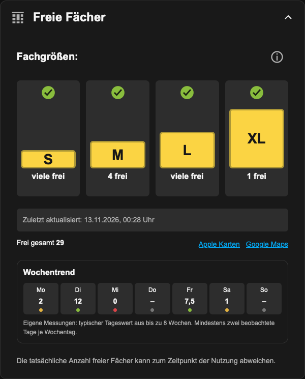
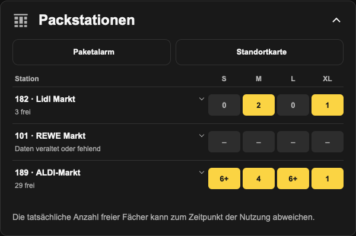

# DHL Packstation

Compare free S, M, L and XL compartments at DHL Packstations and DHL-listed DeinFach lockers in Germany. Add stations by postal code, check where all your parcels fit, and get a Home Assistant notification when a matching station has space.

This is an independent community project, not an official DHL product. See the verification section for test coverage and remaining field checks.

[Latest stable release](https://github.com/TimMixedIt/dhl-packstation/releases/latest) · [Deutsche Installationsanleitung](docs/INSTALLATION_DE.md)

## What it provides

Each station becomes one device with seven entities:

| Entity | Purpose |
| --- | --- |
| Free S / M / L / XL compartments | The exact nonnegative count returned by DHL, including zero |
| Total free compartments | The sum when all four counts are available, plus station coordinates and the local weekday trend |
| DHL data timestamp | The time of DHL's live observation and, when available, DHL's weekday utilization levels as an attribute |
| DHL data stale or missing | A diagnostic problem indicator for missing, old, or implausibly future-dated timestamps |

One shared request per station runs every 15 minutes. Counts expire after 60 minutes by default, without waiting for the next HTTP request. Change the accepted age (30–1440 minutes) in the integration's options. This is a local freshness policy, not a DHL guarantee.

Missing or invalid counts become unavailable individually. Missing, invalid, or old timestamps make the compartment counts unavailable. A network error makes every entity unavailable until a successful update. The timestamp remains visible when a successful response contains old data. Up to five minutes of forward clock skew is tolerated. On HTTP 429 the integration waits at least 15 minutes and honors a longer `Retry-After`, in either seconds or HTTP-date form.

## Requirements

- Home Assistant **2026.10.4 or newer** (Python 3.14.2 or newer when running Core yourself).
- Internet access from Home Assistant to `www.dhl.de` over HTTPS.
- A DHL Packstation or DeinFach locker listed in the DHL location finder. Live counts depend on what DHL reports for that station.

## Installation

### Marketplace / HACS

Search for **DHL Packstation** in **HACS**, or under **Settings → Marketplace** on Home Assistant 2026.11 and newer, and download the integration. Restart Home Assistant, then go to **Settings → Devices & services → Add integration → DHL Packstation** to set up your station.

Enter the station's postal code and number. Leave the station number empty to pick a nearby DHL Packstation or DeinFach locker from the search results. Setup uses the public DHL location finder and requires no DHL account or developer key.

To upgrade from a beta or older release, select **0.4.0** in the repository's version picker if needed, restart Home Assistant and reload the dashboard. Existing station entries, entity IDs and card settings carry over.

### Manual ZIP installation

1. Extract the installation ZIP from the latest stable release. Copy its `custom_components/dhl_packstation` folder to `<HA config>/custom_components/dhl_packstation`. The final path must contain `manifest.json` directly inside `dhl_packstation`.
2. Restart Home Assistant after this manual installation.
3. Go to **Settings → Devices & services → Add integration → DHL Packstation**.
4. Enter the postal code **of the station** and its number, or leave the number blank to choose from nearby DHL and DeinFach lockers. Repeat for additional stations.
5. Open the device to see its entities. Diagnostics may appear in a separate section.

No YAML configuration is used. If you tried the earlier REST example, remove that example yourself after verifying the new integration; its entities are separate and are not migrated or deleted automatically.

## Dashboard cards

**Both cards are included and loaded automatically by the integration.** No second repository, card dependency, or manual resource entry is required. Reload your browser once after adding the integration so the new cards load. The integration never changes your dashboard automatically.

Edit a dashboard → Add card, then choose:

- **DHL Packstation · Freie Fächer**: the single-station card, with four yellow compartment shapes, availability icons, timestamp, help dialog and collapsible header.
- **DHL Packstation · Mehrere Stationen**: compact rows for comparing several stations, with S/M/L/XL, address, timestamp and separate freshness status per station.

Use the visual card editor to select a station or restrict the overview to selected stations. In the overview editor, use the up and down buttons to reorder selected stations. The card follows the order of the `stations` list, including existing lists. Without a selection, the overview shows all configured stations in the default order (postal code, then station number). Above five compartments, the default is “many free”, as on DHL's page. Turn on exact counts in the editor if preferred. Renaming an entity or changing the system language does not break the station-to-sensor mapping. Clicking a compartment opens the corresponding HA more-info dialog.

The cards use HA theme colors in light and dark mode. Unknown/stale/unreachable values have distinct neutral states and never appear as zero. Yellow shape heights illustrate compartment **size**, not occupancy.

The following previews use test fixture data, not live availability:

| Single station | Several stations |
| --- | --- |
|  |  |

Optional YAML examples (the visual editor is sufficient):

```yaml
type: custom:dhl-packstation-card
station: "1-67141189"
show_exact: false
```

```yaml
type: custom:dhl-packstation-overview-card
# Omit stations to show every configured station.
stations:
  - "1-67141189"
  - "1-33104182"
show_station_map: false
show_package_alarm: true
```

Station identifiers can be read from the entities' `dhl_packstation_id` attribute; they are also selected directly by name in the editor.

## Package alarm, map and weekly trend

The multi-station card compares free compartments by size in one row per station. Tap a station name to see its address, update time and directions.

As a Home Assistant administrator:

1. Open **Package alarm** in the toolbar and enter a mix of **exact** sizes, such as **1× S and 2× M**. The comparison shows where everything fits and which sizes are missing as you type.
2. Select the stations to watch and where to send the notification. **HA inbox (no push)** adds a message to the Home Assistant notification bell. Select a device registered with the Companion app for push.
3. Choose **Start search**. The search survives a restart and fires once when a single selected station reports enough fresh compartments. It can fire immediately. Choose **Stop search** to cancel or **New search** after a match.

Automations can use the same functions through `dhl_packstation.start_alarm` and `dhl_packstation.stop_alarm`.

**Station map** loads on demand and shows the stations selected in the overview that have coordinates. Open directions in **Apple Maps** or **Google Maps** from the map panel or a station's details.

In the overview card editor, use **Display** to toggle the package alarm and station map independently. Both are shown by default. Hiding the alarm from a card leaves an active search running.

The single-station card and expanded station rows show **DHL utilization by weekday** when DHL supplies it. Each level is an outlook for the station as a whole. On stations without a DHL estimate, the single-station card shows a **weekday trend** from up to eight weeks of local measurements. It displays the median of observed daily medians after at least two observed dates per weekday.

The four size sensors and the total sensor also support Home Assistant long-term statistics through Recorder. The total is unavailable when any size is missing or stale.

## Remove or update

Remove a station from Devices & services. Its HTTP polling and expiry callback stop when it unloads. Other configured stations continue working.

For a manual update, back up the current component folder, replace it with the new folder, and restart Home Assistant. Stable station identifiers keep entity identities across reloads. Remove the folder only after removing all its entries, then restart. Restore the previous folder and restart to roll back an unsuccessful update.

## Limits and troubleshooting

- This uses the **DHL website's interface**, not a contracted third-party availability API. URLs, fields, and access restrictions can change.
- Compartment numbers are an observation, not a reservation or promise of availability when you arrive. They do not identify a particular parcel or open a locker.
- DHL's page displays “many free” above five compartments; the underlying response may contain the exact number.
- “Unavailable” is not the same as zero free compartments. Check the timestamp, freshness diagnostic, and Home Assistant logs.
- A station-not-found error means the exact postal code, number, and location type could not be verified. A nearby station is never accepted automatically.
- A blocked or unavailable DHL service is not bypassed. Wait before trying setup again if requests are limited.
- The integration does not calculate occupancy percentages: no verified per-size total capacity is available.

Home Assistant generates entity IDs from names and language. Use the actual entity IDs shown by your installation in automations, and check availability before numeric comparisons. The package alarm actions can also be used in automations.

## Privacy

During setup, the postal code and any entered station number are sent to DHL to find public location identifiers. Subsequent requests send that identifier. DHL also sees the requesting IP address. Identifiers are saved in Home Assistant's config entry. The weekly observations and alarm are stored on your Home Assistant instance. Opening the map can load external map tiles, and selecting a phone uses the Companion app’s notification delivery. No DHL credentials, parcel numbers, personal Postnummer, analytics, or external proxy service are used.

## Development and verification

Current test environment:

```sh
uv venv --python 3.14
uv pip install --python .venv/bin/python --group dev
.venv/bin/ruff check .
.venv/bin/ruff format --check .
.venv/bin/python -c 'import homeassistant; import pytest; raise SystemExit(pytest.main(["-q", "--cov"]))'
```

The Home Assistant import before pytest initializes its HTTP library aliases before unrelated pytest plugins load. For the 2026.10.4 compatibility run, use a separate environment with `pytest-homeassistant-custom-component==0.13.375` and `ruff==0.14.5` instead of the current development group. Tests use the matching helper package in each environment. No Home Assistant dependency is overridden to force an incompatible test harness.

Run the dependency-free JavaScript checks with Node.js 22 or newer:

```sh
node --test tests/frontend/*.test.mjs
```

The browser CI jobs run the real bundled elements in Chromium and WebKit with Home Assistant state fixtures. They cover both themes at 320/768/1024/1440px and 280/320/360px cards inside narrow and wide browser windows, card selection, stale data, recovery, more-info events, the visual editor, keyboard navigation, and axe WCAG A/AA checks. It is a component/browser test, not an end-to-end test inside a production Home Assistant installation.

Automated tests use the real Home Assistant flow, config entry, device, entity, timer, and coordinator implementations with mocked DHL HTTP responses. External sockets are disabled in these tests. Live requests are a separate, explicitly recorded check. See [the German field test plan](docs/TESTPLAN_DE.md), [release checklist](docs/RELEASE_CHECKLIST.md), and [source references](docs/SOURCES.md).

## License

MIT. DHL and Packstation are names of their respective owners. The generic locker icon was drawn for this project and does not use the DHL or Home Assistant logo.
